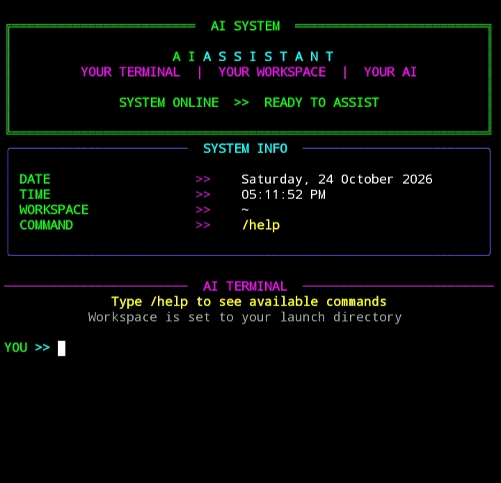

# 🤖 Ai-Assistant



A personal AI assistant for Termux on Android, with OpenRouter and optional Google Gemini support. It also offers workspace file tools, shell command execution with confirmation, persistent per-project memory, and optional voice interaction.

## Features

- OpenRouter as the primary AI provider
- Optional Google Gemini fallback (native SDK with signature-safe tool calls)
- Provider fallback when an earlier provider fails
- Workspace file listing, reading, writing, editing, and deletion
- Shell command execution with hardened safety checks and confirmation
- Local Python HTTP server (binds to 127.0.0.1) and process tools
- **Persistent per-project memory** with `/project init|save|resume|sync`
- **Auto-resume** on startup with context injection into the AI
- Optional voice input and spoken responses
- Local, private API-key storage

## Requirements

- Android with [Termux](https://github.com/termux/termux-app)
- Python 3 and Git
- An API key for at least one supported provider
- Termux:API app and package for optional voice features

## Quick Installation

Update Termux and install dependencies:

```bash
pkg update && pkg upgrade -y
pkg install python git -y
```

Clone the project and run the installer:

```bash
git clone https://github.com/souravpaul-ind/Ai-Assistant.git
cd Ai-Assistant
bash setup.sh
```

The installer configures OpenRouter first. Gemini setup is optional: choose Yes to configure it or press Enter to skip. Existing non-empty key files are preserved and are not prompted for again.

Start the assistant:

```bash
ai
```

To use a particular project as the workspace, launch the assistant from that folder:

```bash
cd ~/my-project
ai
```

## AI Providers and API Keys

You only need a valid key for at least one provider. Configure more providers to enable fallback.

| Provider | Get an API key | Local key file |
|---|---|---|
| OpenRouter | https://openrouter.ai/keys | `~/.config/openrouter/key` |
| Google Gemini | https://aistudio.google.com/apikey | `~/.config/gemini/key` |

### OpenRouter

OpenRouter provides access to models available through its service. API access, model availability, and usage limits depend on the selected model and your account.

Key file:

```text
~/.config/openrouter/key
```

### Google Gemini

Gemini is Google's AI API. Create a key in Google AI Studio and save it in the following file:

```text
~/.config/gemini/key
```

API access, model availability, and billing or usage limits are controlled by each provider. A key does not guarantee free usage.

### Add or change a key later

Create the relevant directory and open the desired key file locally. For example, to configure Gemini:

```bash
mkdir -p ~/.config/gemini
nano ~/.config/gemini/key
chmod 700 ~/.config/gemini
chmod 600 ~/.config/gemini/key
```

Use `~/.config/openrouter/key` for OpenRouter. Never paste an API key into a public issue, chat, screenshot, README, or source code.

### Provider fallback

The assistant tries OpenRouter first and then Gemini if Gemini is configured. If a provider request fails, the assistant can try the next provider. All providers can still fail due to network problems, invalid keys, rate limits, model availability, or account restrictions.

## Start the Assistant

```bash
ai
```

Common chat commands:

| Command | Description |
|---|---|
| `/help` | Show available commands |
| `/listen` | Capture voice input |
| `/speak on` | Enable spoken replies |
| `/speak off` | Disable spoken replies |
| `/approve on` | Skip approval for low-risk actions (high-risk still prompted) |
| `/approve off` | Require approval for all protected actions |
| `/project init` | Initialize project memory for this workspace |
| `/project save` | Save current project state summary |
| `/project resume` | Load memory and report status (read-only) |
| `/project sync` | Copy source files to `$PREFIX` install dir |
| `/clear` | Clear conversation history |
| `/exit` | Exit the assistant |

## Optional Voice Setup

Install the Termux API package:

```bash
pkg install termux-api -y
```

Install the compatible Termux:API Android app, grant required permissions, and ensure Android speech recognition and text-to-speech services are available.

## Tools and Safety

Depending on the installed version, the assistant can list, read, create, edit, and delete workspace files, run shell commands, start a local HTTP server, and stop processes.

Safety layers:

- **Hard-blocked**: `sudo`, `su`, `doas`, `tsu`, `mkfs*`, `fdisk`, `parted`, `wipefs`, `reboot`, `shutdown`, `poweroff`, `halt`
- **Blocked**: Any command or file path referencing known API-key files
- **High-risk (approval required)**: `rm`, `rmdir`, `shred`, `unlink`, `truncate`, `dd`, `chmod`, `chown`, `kill`, `pkill`, `find -delete`, `python -c` with file mutation, `> /absolute`, `>> /absolute`, `| sh`, `eval`, `exec`
- **Outside-workspace access**: Explicit approval required
- **Duplicate approval prompts**: Eliminated — one prompt per operation
- **Local HTTP server**: Binds to `127.0.0.1` only

Review every requested operation before approving it. Workspace restrictions do not make every shell command safe.

## Project Memory (Resume Projects)

The assistant can remember a project across sessions, so you do not need to re-explain the project every time you restart.

Memory is stored **outside** the workspace:

```text
~/.config/ai-assistant/projects/<workspace-name>-<hash>.json
```

Each workspace gets its own file, so different projects never mix. Secrets, API keys, and tokens are redacted before saving.

### Commands

| Command | What it does |
|---|---|
| `/project init` | Scan the workspace and create a memory file (read-only scan) |
| `/project save` | Checkpoint the current state (file index + summary) |
| `/project resume` | Load memory and print a status summary (inspection-only, no file changes) |
| `/project sync` | Copy current source files into the `$PREFIX` install directory |

### Automatic resume

On startup, if memory exists for the current workspace, the assistant asks:

```text
Saved project found. Resume previous work? [y/N]
```

- **`y`** — show the summary **and** inject it into the AI's system prompt so the model has project context from the first message
- **`n`** — start a normal fresh session; memory remains on disk

### Auto-save

When project memory exists and a tool successfully writes, edits, deletes, or creates a directory, the assistant automatically checkpoints memory and prints:

```text
(project memory autosaved after write_file)
```

### Stale detection

`/project resume` compares the saved file index against the current files and reports changed files. Resume itself never modifies or deletes project files.

### Sync installed copy

When you edit `~/Ai-Assistant/` (source), the `ai` launcher still runs the copy in `$PREFIX/share/Ai-Assistant/`. To copy the latest source files into the install directory, use `/project sync` inside the assistant, or manually:

```bash
cp ~/Ai-Assistant/assistant.py ~/Ai-Assistant/project_memory.py ~/Ai-Assistant/ui.py ~/Ai-Assistant/voice.py ~/Ai-Assistant/README.md "$PREFIX/share/Ai-Assistant/"
```

Or one command:

```bash
printf '/project sync\n/exit\n' | AI_WORKDIR=~/Ai-Assistant python ~/Ai-Assistant/assistant.py
```

## Troubleshooting

### API key missing or invalid

- Confirm that the correct provider key file exists.
- Check that the key was entered correctly without printing it to the terminal.
- Confirm that the provider account and API access are active.
- Check the provider's usage limits and model availability.

Check file permissions without displaying the key:

```bash
ls -l ~/.config/openrouter/key ~/.config/gemini/key
```

A missing file may produce a warning; configure that provider using the installer or create its key file manually.

### OpenRouter and Gemini both fail

Check your internet connection, API keys, provider account limits, and selected model availability. Fallback cannot work if OpenRouter fails and Gemini is not configured or is also unavailable.

### The `ai` command is not found

Check whether the installer completed and whether the launcher exists:

```bash
ls "$PREFIX/bin/ai"
```

### Voice input or speech is not working

Check that the Termux:API Android app and `termux-api` package are installed, permissions are granted, and Android speech services are available.

### `/project` commands show "project_memory module unavailable"

The installed copy is missing `project_memory.py`. Copy it from source:

```bash
cp ~/Ai-Assistant/project_memory.py "$PREFIX/share/Ai-Assistant/"
```

Or run `/project sync` from a working source copy.

## Security

- Keep API keys private and out of Git.
- Key files should have permission `600`; their configuration directories should have permission `700`.
- Never print or share key contents.
- Review shell commands and destructive operations before approving them.
- Project memory is stored outside the workspace; secrets are redacted before saving.
- Back up important files before making automated changes.

## Project Structure

```text
Ai-Assistant/
├── assistant.py        # Main AI logic, tools, safety, commands
├── project_memory.py   # Persistent per-project memory engine
├── ui.py               # Terminal UI (Rich)
├── voice.py            # Voice helpers (Termux:API)
├── setup.sh            # Installer
└── README.md           # This file
```

## License

Check the repository for the project's license and usage terms.

Made for Termux users who want an AI assistant in their terminal.
```
